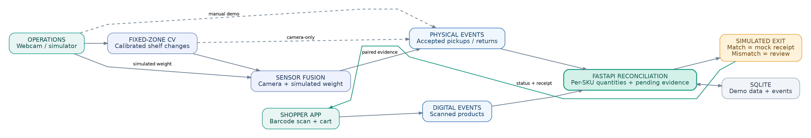

# SmartCart AI — Scan. Verify. Go.

**A checkout-anywhere loss-prevention prototype for mobile scan-and-go shopping.**

SmartCart AI compares a customer's **digital cart** (mobile barcode scans) with a separate **physical cart** (shelf pickup/return observations). If they match and no unresolved sensor evidence remains, the app permits a **simulated** checkout. Otherwise, it requests review instead of silently charging the customer.

> **Prototype scope:** One active shopping session, three fixed shelf zones (one product in each), optional laptop-webcam observations, **simulated** shelf-weight events and **mock** billing. Not a production anti-theft system or a validated multi-shopper product.

## Product at a glance

| Challenge | Our MVP approach |
| --- | --- |
| An item is picked up without being scanned | Compare shelf-observed quantity with scanned quantity and flag a discrepancy |
| A scan is recorded for the wrong item | Reconcile per-product quantities; optional appearance check is *advisory only* |
| Sensor readings disagree | Hold them as pending or uncertain evidence and block checkout |
| Customer reaches the exit | Simulate exit verification; reject unresolved carts; issue a **mock** receipt only after matching |
| Duplicate exit attempt | Return the existing receipt rather than creating a new one |

### Demonstration SKUs

| Zone | Product | Demo barcode | Price |
| --- | --- | --- | ---: |
| A | Shampoo | `8901234500019` | ₹199 |
| B | Biscuits | `8901234500026` | ₹20 |
| C | Cola | `8901234500033` | ₹40 |

These are demonstration barcodes, not guaranteed commercial retail barcodes.

## Architecture



[Editable architecture source](docs/PHASE8_ARCHITECTURE.md) · [Full-size SVG](docs/SmartCart-Architecture.svg)

**Core stack:** React + Vite + ZXing; FastAPI; OpenCV fixed-zone image comparison; SQLite for the prototype. Sensor weight readings are simulated. Optional YOLO/ByteTrack is an overlay only, and reference-image SKU matching is experimental; neither automatically updates the cart.

## Getting started (Windows PowerShell)

Requirements: Python **3.11–3.13**, Node.js 20+, and a stable webcam only if you want the camera variant.

**Terminal 1 — FastAPI**

```powershell
cd "$HOME\Desktop\SmartCart-AI\backend"
py -m venv .venv
.\.venv\Scripts\Activate.ps1
python -m pip install -r requirements.txt
python -m uvicorn main:app --reload --port 8000
```

Open [backend docs](http://localhost:8000/docs).

**Terminal 2 — React/Vite**

```powershell
cd "$HOME\Desktop\SmartCart-AI\frontend"
npm install
npm run build
npm run dev
```

Open [SmartCart AI](http://localhost:5173). Run `npm install` inside `frontend`, **not** the project root. If `venv` activation is blocked by PowerShell, use `Set-ExecutionPolicy -Scope Process -ExecutionPolicy Bypass` in that terminal.

## Render demo deployment

The repository includes a Render Blueprint and Dockerfile for a single web service that builds the React frontend and serves it through FastAPI on the same HTTPS origin. Push the project to a Git repository, then create a Blueprint in Render from that repository and deploy `render.yaml`.

This public demo uses a temporary SQLite database at `/tmp/smartcart.db`; cart state resets when the Render instance restarts or redeploys. It has no user authentication and is intended only for non-sensitive demonstration data. Do not add personal data, real customer sessions, or payment credentials. Camera use requires browser permission and HTTPS; simulated checkout does not charge money.

## The 2-minute judge demo (most reliable mode)

1. Open **Shopper app → Five-step judge walkthrough**, then **Reset demo**.
2. In **Shelf operations**, manually **Pickup Shampoo** (a **simulated physical event**).
3. In Shopper app, **Simulate Customer Reaching Exit**. Checkout should be blocked: physical Shampoo × 1, scanned × 0.
4. **Demo scan Shampoo**. Both quantities become 1; the total becomes **₹199**.
5. Simulate exit again. You get **one mock receipt**; repeat to show duplicate prevention.

No product camera or weight sensor is needed for this stable path. For **real webcam** and **two-signal simulated-weight** variants, follow [Phase 7 demo instructions](docs/PHASE7_DEMO_GUIDE.md). Do not claim that a simulator click was generated by a camera.

## Test evidence

Run from `backend`:

```powershell
python -m pip install -r requirements-dev.txt
python scripts/run_phase7_acceptance.py
```

At the end of Phase 7, **22 backend automated tests passed**. These cover synthetic camera frames, simulated sensor events, reconciliation, safe exit denial, and duplicate-receipt behavior. They **do not** prove the frontend production build, smartphone camera scanning, real webcam accuracy, physical weight sensors, or any real payments. [View stored Phase 7 results](reports/phase7-acceptance.json).

## Submission package

- [Pitch deck](submission/SmartCart_AI_Pitch_Deck.pptx)
- [Short project abstract](submission/SmartCart_AI_Abstract.md)
- [Two-minute presentation script](docs/PHASE8_DEMO_SCRIPT.md)
- [Architecture and data flow](docs/PHASE8_ARCHITECTURE.md)
- [Final submission checklist](docs/PHASE8_SUBMISSION_CHECKLIST.md)
- [Full technical and endpoint notes](docs/TECHNICAL_DETAILS_PHASE7.md)

## Limits, privacy and future work

This is a **local demonstration**, without authentication or real payment authorization. Camera processing is heuristic, limited to fixed lighting and a stable camera. The application is designed for one shopper and a single object per zone. Cameras do **not** establish intent or prove theft. Do not expose the unauthenticated backend to the public internet. Camera frames are used transiently in zone monitoring; experimental learned SKU templates may be saved locally.

Next: validate locally with real products and a phone, measure false positives/negatives, integrate ESP32 + load cells, add authenticated sessions and multi-customer event association, harden privacy/retention, and only then evaluate payment integration.

**SmartCart AI: pick, scan, verify, exit — with a review path when evidence is uncertain.**
