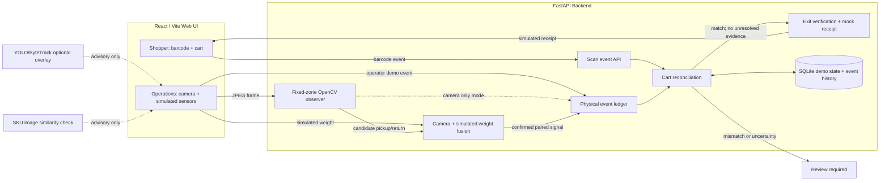

# SmartCart AI — Prototype Architecture (Phase 8)

The chart below is **editable Mermaid**. Render it in GitHub Markdown, Mermaid Live Editor, or supported documentation tooling.

## Event lifecycle

1. Shopper scans → scanned product count changes through `/api/scan`.
2. Camera zone can report a candidate pickup/return when calibrated; a manual event simulator offers a deterministic fallback.
3. In two-signal mode, camera event and **simulated** shelf-weight change must agree before modifying the physical cart. Pending or ambiguous evidence blocks checkout.
4. Reconciliation checks quantity per SKU and unresolved evidence.
5. Simulated exit attempt gives review-required status or a mock receipt; repeated exit attempts return the receipt already created.

## Trust boundaries

- **Browser to API:** no authentication in MVP; local trusted environment only.
- **Observation to physical ledger:** accepted transitions only; rejected observations do not count as physical changes.
- **Camera and recognition:** camera heuristics and product appearance are not proof of physical possession, identity or intent.
- **Checkout:** simulated payment only. No card storage, charging, actual gate control or access authorization.

## Prototype vs production

| Prototype | Additional production capability needed |
| --- | --- |
| Single session | Secure user identity and session-to-event association |
| Three fixed zones | Catalog-wide SKU modeling and real shelf layout |
| Simulated weight evidence | Physical load cells, calibration and telemetry checks |
| Local SQLite | Auditable scalable data store and real-time infrastructure |
| Mock payment | Consent-based payment processing and dispute handling |
| No stored raw camera history by default | Clear retention and privacy/security policy |
